# CareSync Health Network — Metadata-Driven Data Platform on Azure &amp; Databricks

An end-to-end, metadata-driven data engineering project for a multi-hospital
healthcare network. It ingests relational data from an internal hospital
system (PostgreSQL) alongside recurring file-based feeds from external
partners (CSV), then transforms everything through a Bronze–Silver–Gold
medallion architecture on Databricks — all driven by a single reusable Azure
Data Factory pipeline configured entirely from a SQL control table, with
every run automatically audited and reported by email.

## Architecture

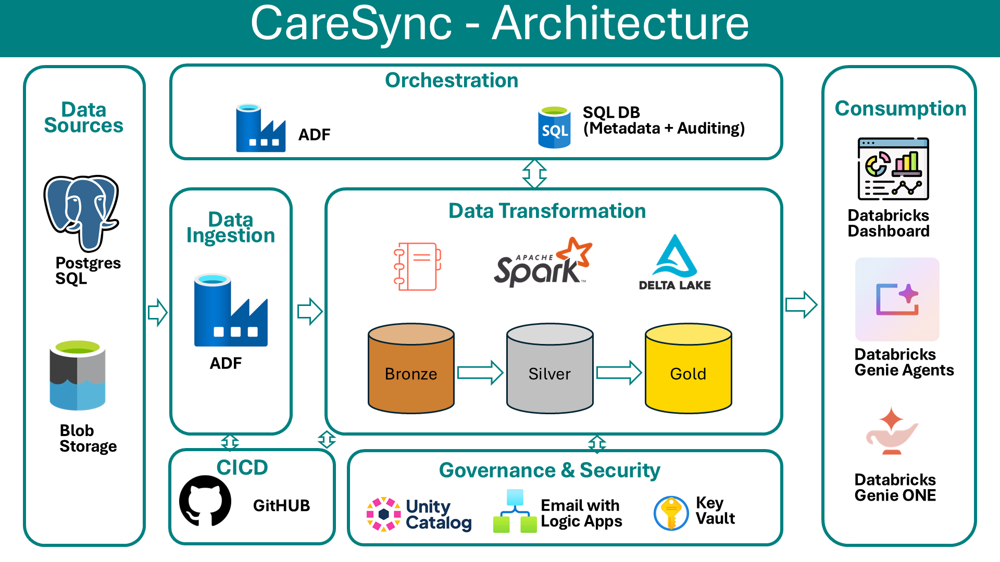

Data flows from the source systems on the left through ingestion,
transformation, and out to consumption, with orchestration, governance, and
CI/CD wrapped around the pipeline rather than sitting inside it:

- **Ingestion** — Azure Data Factory, driven by metadata rather than one
  pipeline per table.
  

  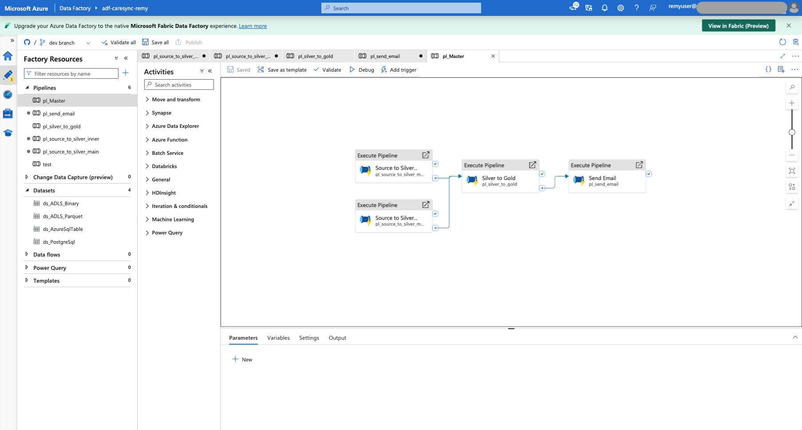
  &nbsp;&nbsp;
  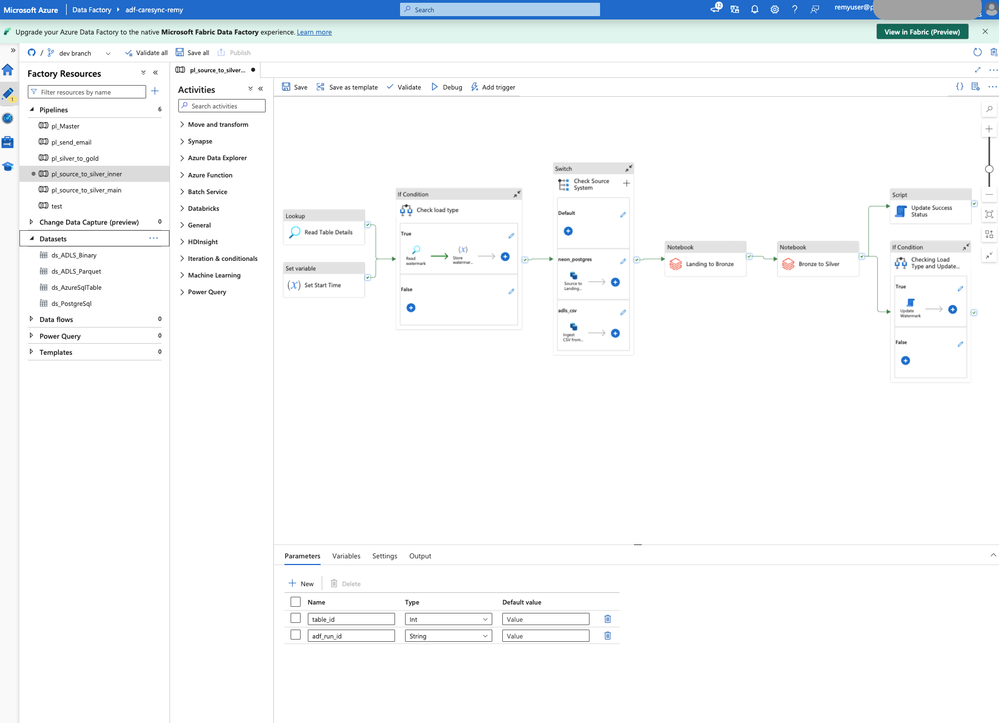
  

  

    
📸 <i> Click to view other Pipelines </i> 

     
    
    **adf_pipeline_monitor**  
    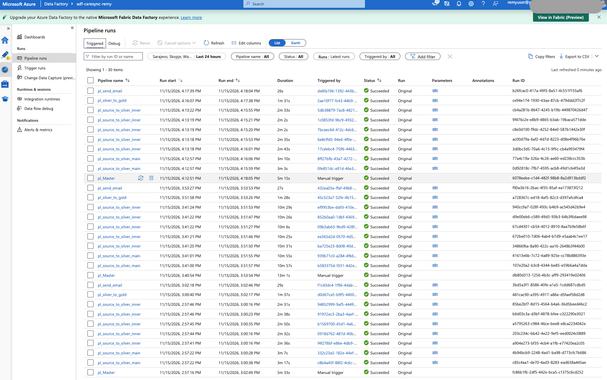
    
    **pl_silver_to_gold**  
    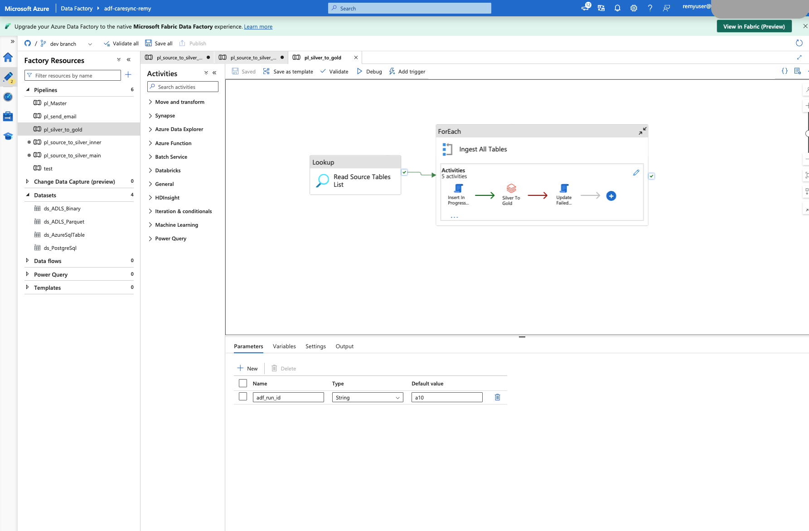
    
    **pl_source_to_silver_main**  
    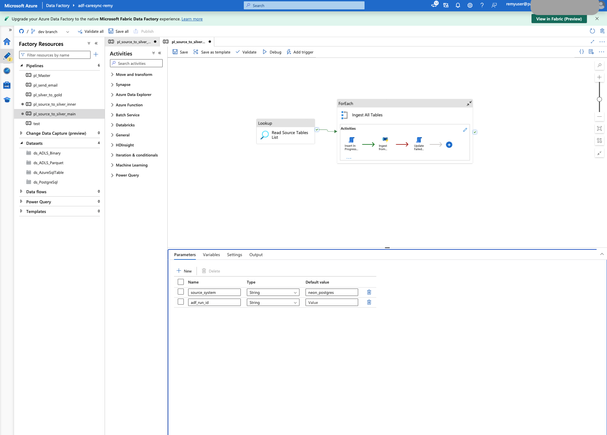
    
    **pl_send_email**  
    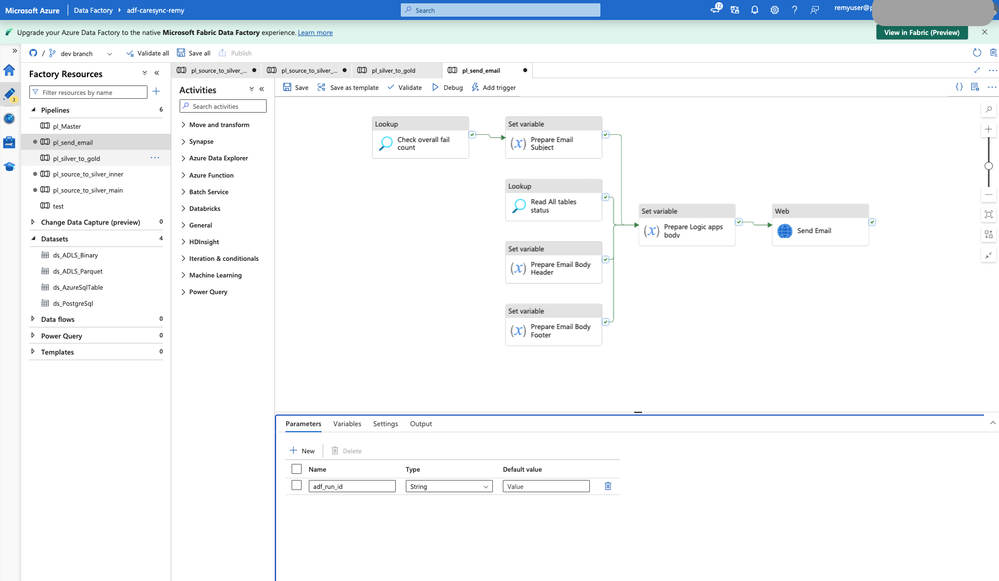
    
    **Linked_services**  
    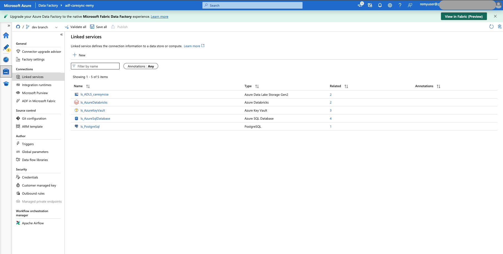
  

- **Transformation** — Databricks (PySpark, Delta Lake), through Bronze,
  Silver, and Gold layers.  
  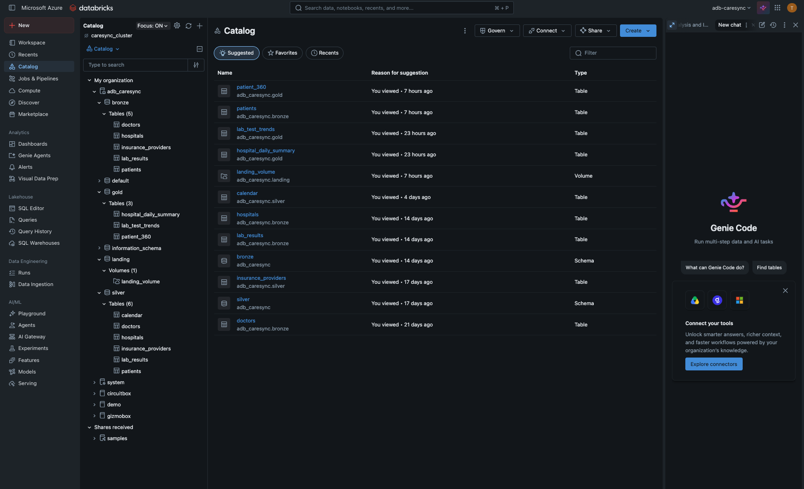
- **Orchestration** — Azure Data Factory pipelines plus a SQL database
  holding the control/metadata and audit tables.  
- **Governance &amp; Security** — Unity Catalog, Azure Key Vault, and Azure
  Logic Apps for automated email notifications.  
  

    
 📸 <i> Click to view Logic Apps, Azure Key Vault and email notification </i> 

     
    
    **logic_apps**  
    
    
    **Gmail notification**  
    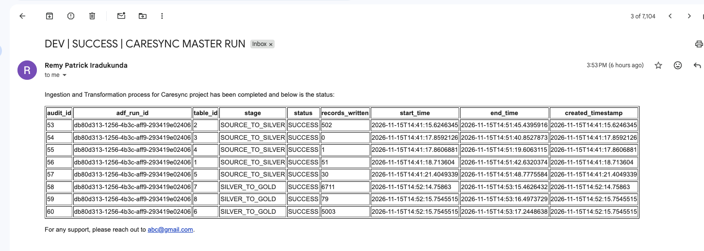
    
    **Key Vault**  
    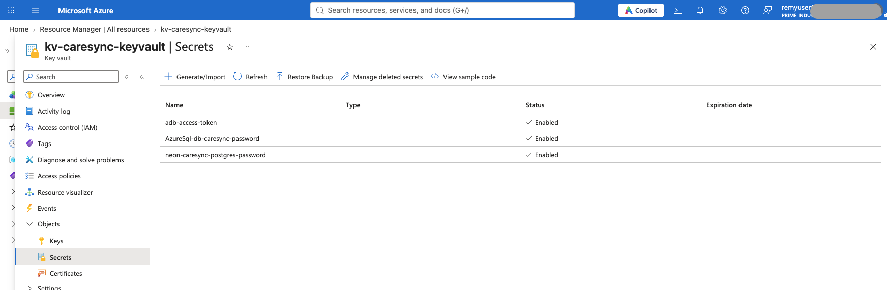
    
  

  
- **CI/CD** — GitHub, for both the Azure Data Factory and Databricks repos.
- **Consumption** — Databricks AI/BI Dashboards, Genie Agents, and Genie ONE.  
  

## Key Features

- **Metadata-driven ingestion** — a single Azure Data Factory pipeline
  ingests every source, relational or file-based, based on rows in a SQL
  control table. Onboarding a new source means adding a row, not writing a
  new pipeline.
    
    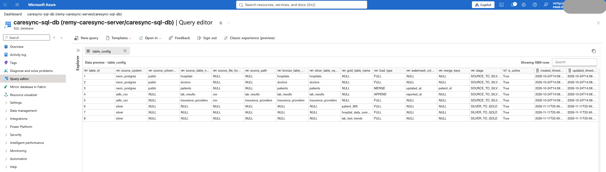
- **Full and incremental loads** — full-reload, append, and watermark-based
  merge load strategies, all handled by the same generic notebooks.
- **Bronze–Silver–Gold medallion architecture** — raw, standardized, and
  curated reporting layers on Delta Lake, with a supporting calendar
  dimension table.
- **Automated auditing &amp; alerting** — every stage of every run is logged,
  and a status email (with a dynamic subject and an HTML results table) goes
  out automatically via Azure Logic Apps, whether the run succeeds or fails.
  

  
  &nbsp;&nbsp;
  
  

  
- **Governed, credential-less storage access** — Unity Catalog storage
  credentials and managed identities throughout; no account keys or
  passwords in any pipeline definition.
- **CI/CD for both platforms** — feature-branch and pull-request workflows
  for Azure Data Factory and Databricks Repos alike.
- **Multiple consumption surfaces** — a multi-page Databricks dashboard, a
  scoped Genie Agent, and a workspace-wide Genie ONE natural-language
  interface, all built on the same gold tables.

## Repository Structure

| Folder | Contents |
|---|---|
| `Azure Data Factory Repository/` | The full ADF Git-integrated repo — pipelines, datasets, linked services, and factory/publish config. |
| `Databricks_Repository/` | The Databricks notebooks — Landing-to-Bronze, Bronze-to-Silver, the calendar dimension builder, and the three Gold-layer reporting notebooks. |

## Tech Stack

Azure Data Factory · Azure Data Lake Storage Gen2 · Azure SQL Database ·
Azure Key Vault · Azure Logic Apps · Databricks · Delta Lake · Unity Catalog ·
PySpark · PostgreSQL · GitHub

